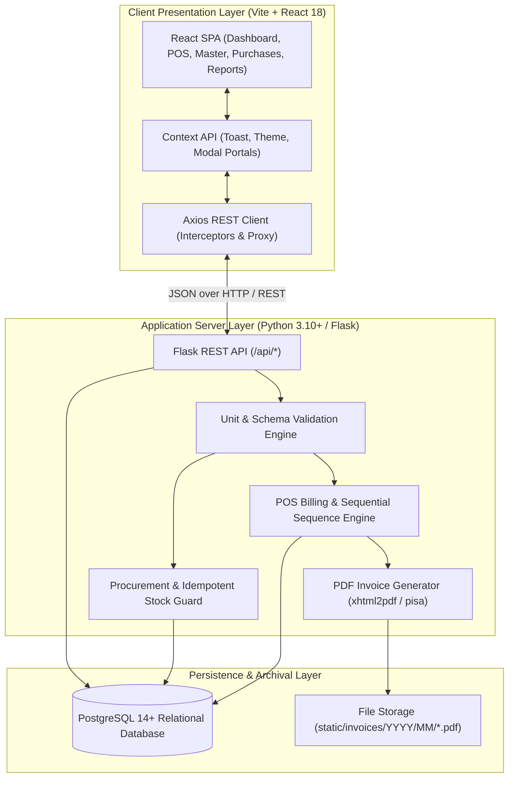
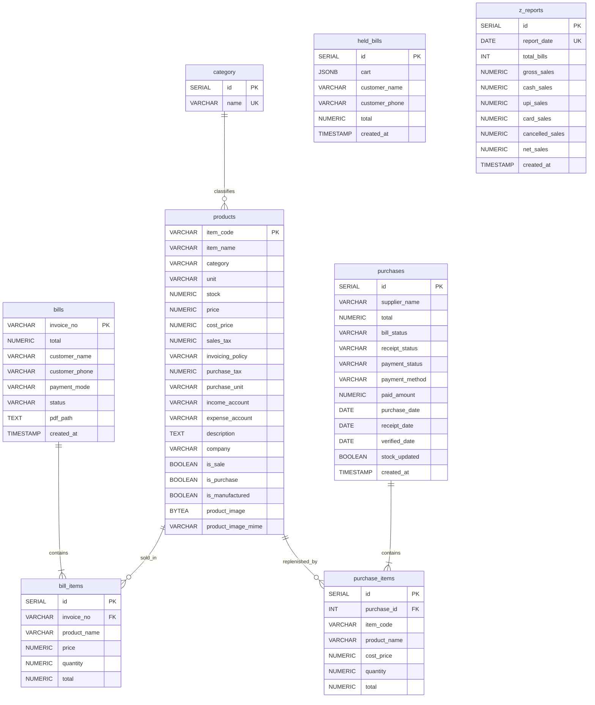

<div align="center">

  

  # 🐼 PANDAS ERP
  ### Modern Retail Point of Sale (POS), Inventory Control & Financial Management System

  [](https://www.python.org/)
  [](https://flask.palletsprojects.com/)
  [](https://react.dev/)
  [](https://vitejs.dev/)
  [](https://tailwindcss.com/)
  [](https://www.postgresql.org/)
  [](LICENSE)

  <p align="center">
    A high-throughput, enterprise-grade retail operations platform engineered for confectioneries, dry fruit & nut merchants, FMCG supermarkets, and retail stores. Combines an ultra-responsive React 18 single-page application with a resilient Python/Flask REST backend and a relational PostgreSQL database.
  </p>

  <p align="center">
    <a href="#-quick-start">Quick Start</a> •
    <a href="#-key-features">Key Features</a> •
    <a href="#-system-architecture">Architecture</a> •
    <a href="#-database-schema">Database Schema</a> •
    <a href="#-rest-api-documentation">API Reference</a> •
    <a href="#-production-deployment">Production Guide</a>
  </p>

</div>

---

## 📖 Overview

**PANDAS ERP** is a full-stack retail management suite crafted to eliminate bottlenecks during peak store hours while keeping financial accounting, vendor shipments, and product inventory perfectly aligned.

### Why PANDAS?
* ⚡ **Zero-Latency Checkout**: Real-time cart calculations, keyboard-accessible workflows, inline price/quantity overrides, and transaction parking (**Hold & Resume bills**).
* 🛡 **Strict Unit & Stock Integrity**: Decimal-aware arithmetic for loose goods (`kg`, `gm`, `ltr`, `m`) alongside integer enforcement for discrete goods (`pc`, `box`, `btl`), preventing fractional stock errors.
* 📦 **Decoupled Procurement Statuses**: Physical Goods Receipt (`Pending Receipt`, `Received`, `Verified`) is completely decoupled from Financial Settlement (`Paid`, `Partially Paid`, `Unpaid`), ensuring stock is never incremented twice and receiving goods never erroneously marks an invoice as paid.
* 🧾 **Automated Invoicing & Closing**: Instant PDF invoice generation via `xhtml2pdf` with automatic archival by year/month, accompanied by immutable end-of-day **Daily Z-Report** register closings.
* ✨ **Bespoke Luxury UI**: Built on an enterprise **Gold-Black-White** design system (`#111111` Charcoal, `#F5B900` Gold, `#FAF9F5` Main Background, `#FFFFFF` Cards).

---

## 🚀 Key Features

### 🧾 1. Point of Sale (POS) & Fast Billing
* **Multi-Category Quick Tabs**: Instant department navigation across *Chocolates, Nuts, Dates, Dry Fruits, Drinks, Mill Products*, and custom categories.
* **Smart Live Cart**: Real-time line item subtotals, GST/tax computation, and instant item removal or inline quantity tweaks.
* **Held Bills (Parked Transactions)**: Park active carts to the database (`held_bills`) when customers need time, serve the next shopper, and resume with a single click.
* **Flexible Multi-Channel Tender**: Record payments seamlessly via **Cash**, **UPI** (GPay, PhonePe, Paytm), **Card**, or **Credit/Split**.
* **Automated Sequential Numbering**: Generates standardized invoice numbers with annual reset: `INV-YYYY-XXXXX` (e.g., `INV-2026-00042`).
* **Instant Stock Decrement**: Atomically decrements catalog inventory in PostgreSQL upon checkout finalization.
* **Dual Print Engine**: Thermal receipt printer layout (80mm/58mm) and full A4 tax invoice printouts with automatic browser print triggering.

### 📦 2. Catalog Master & Inventory Control
* **Comprehensive SKU Profiles**: Manages SKU code, product name, category, stock balance, unit of measure, selling price, cost price, GST tax rates, ledger accounts, and brand manufacturer.
* **Automated SKU Nomenclature**: Dynamically suggests next-in-sequence SKU codes based on category prefixes (e.g. `C101`, `N101`, `D101`).
* **Binary Image Storage**: Direct image upload and streaming stored securely as `BYTEA` blobs with MIME validation in PostgreSQL.
* **Fast Inline Updates**: Update selling prices and stock quantities directly from the table without opening full edit modals.
* **Instant Filter Reset**: Dedicated, persistent **Reset Filters** button that clears search queries, department filters, stock health states, and sorting in one click without page refreshes.
* **Unit Validation Guard**: Automatic client and server validation ensuring integer units (`pc`, `box`, `bottle`) cannot have fractional values, while weight/volume units (`kg`, `gm`, `ltr`) support high-precision decimals.

### 🛒 3. Inward Procurement & Purchase Auditing
* **Independent Goods Receipt Status**:
  * `Pending Receipt`: Shipment in transit. Database stock is **not** increased.
  * `Received`: Physical goods arrived at the shop. Catalog inventory is updated automatically.
  * `Verified`: Stock inspected and accepted against vendor delivery challan/PO.
  * `Partially Received`: Partial deliveries safely tracked.
* **Automated Financial Settlement**:
  * Calculates `Paid`, `Partially Paid`, or `Unpaid` dynamically based on grand total vs. actual recorded payments.
  * Support for partial supplier payments with balance due tracking.
  * Physical arrival and verification never inadvertently alter payment settlement.
* **Idempotent Stock Protection**: Guarded by `stock_updated` boolean flags to guarantee inventory is updated once and never duplicated.
* **Consignment Audit Ledger**: Filter historical consignments by supplier and invoice date with line-item breakdowns.

### 📊 4. Financial Reports & End-of-Day Z-Report
* **Date-Range Sales Analytics**: Visual revenue metrics, department sales share, and SKU velocity reports.
* **Daily Z-Report Settlement (`/z-report`)**:
  * Audits total invoices, gross sales, cancellations, and net revenue.
  * Detailed payment breakdown across Cash, UPI, and Card.
  * **Immutable Audit Trail**: Once generated for a given business day, the Z-Report freezes into the `z_reports` database table to prevent post-close tampering.
  * Thermal register receipt layout with auto-print execution.

---

## 🏗 System Architecture



---

## 🗄 Database Schema

The database leverages PostgreSQL with foreign key constraints, indexes, and transactional consistency:



---

## 📁 Directory Structure

```text
pandass/
│
├── app.py                      # Flask REST API controllers, routing & business logic
├── db.py                       # PostgreSQL connection pool & resilient reconnect logic
├── billing.py                  # POS arithmetic, cart validation, tax calculation
├── reports.py                  # Analytical queries, category aggregation, Z-Reports
├── prod_import.py              # CSV bulk catalog seeding with conflict guards
├── products.csv                # Sample product inventory catalog
├── schema.sql                  # Comprehensive PostgreSQL DDL initialization schema
├── requirements.txt            # Python backend dependencies
├── start.bat                   # 1-click Windows startup script (Flask + Vite)
├── start.ps1                   # 1-click PowerShell startup script
├── README.md                   # Enterprise system documentation
│
├── frontend/                   # Modern React 18 Single-Page Application
│   ├── package.json            # Node.js dependencies & Vite scripts
│   ├── vite.config.js          # Vite configuration with API proxy rules
│   ├── tailwind.config.js      # Enterprise gold-black color palette tokens
│   ├── index.html              # HTML5 application shell & font imports
│   └── src/
│       ├── main.jsx            # React root mount
│       ├── App.jsx             # Application router & base layout wrapper
│       ├── index.css           # Global Tailwind directives & modal portal styling
│       ├── components/
│       │   ├── common/         # Reusable Modal (createPortal), Badge, Loading
│       │   └── layout/         # Sidebar navigation & TopHeader component
│       ├── context/            # ToastContext notification engine
│       ├── pages/
│       │   ├── Dashboard/      # Executive KPIs, shop banner & stock alerts
│       │   ├── Billing/        # High-speed POS terminal & parked bill drawer
│       │   ├── Products/       # Catalog master, SKU generator & quick edits
│       │   ├── Purchases/      # Inward procurement with receipt & payment separation
│       │   ├── PurchaseHistory/# Purchase audit history & PO verification
│       │   ├── Bills/          # Historical invoice search & PDF previews
│       │   ├── Reports/        # Date-range sales performance & category share
│       │   └── ZReport/        # End-of-day register closing & thermal receipt
│       ├── services/
│       │   └── api.js          # Axios API service clients
│       └── utils/
│           └── unitValidation.js# Integer vs decimal unit validator
│
├── static/                     # Assets & PDF Archives
│   ├── images/
│   │   ├── Psym.png            # Sidebar emblem symbol
│   │   ├── logo.png            # Complete PANDAS logo
│   │   ├── logoo.png           # Banner emblem with gold backdrop
│   │   └── logob.png           # Customer receipt & print logo
│   └── invoices/               # Generated invoice storage (YYYY/MM/*.pdf)
│
└── templates/                  # Jinja2 Server-side HTML & PDF Templates
    ├── bill.html               # Print & xhtml2pdf invoice document template
    ├── z_report.html           # Thermal register closing slip
    └── ...                     # Legacy views maintained for backwards compatibility
```

---

## 💻 Tech Stack

| Domain | Technology | Description |
| :--- | :--- | :--- |
| **Frontend Framework** | **React 18** | High-performance SPA with concurrent rendering |
| **Build Tool** | **Vite 5** | Instant HMR development and optimized production bundles |
| **Styling** | **Tailwind CSS 3.4** | Utility-first CSS with customized enterprise tokens |
| **Icons** | **Lucide React** | Clean, lightweight enterprise SVG icon suite |
| **Routing** | **React Router DOM v6** | Declarative client-side routing & search params handling |
| **HTTP Client** | **Axios** | Promised-based HTTP client configured with proxying |
| **Backend Framework**| **Python 3.10+ / Flask 2.3+**| Lightweight REST API architecture |
| **Database** | **PostgreSQL 14+** | ACID-compliant relational storage engine |
| **Database Driver** | **psycopg2-binary** | High-speed C-based PostgreSQL driver |
| **PDF Rendering** | **xhtml2pdf (`pisa`)** | Converts HTML/CSS templates into PDF documents |
| **Templating** | **Jinja2** | High-fidelity server-side invoice generation |

---

## 🎨 Enterprise Design System

The platform implements a luxury gold-charcoal-white enterprise visual language:

```text
Deep Charcoal:   #111111   (Sidebar, Headers, Primary Headings)
Charcoal Muted:  #1A1A1A   (Secondary Surfaces)
Brand Gold:      #F5B900   (Active Navigation, Buttons, Accents)
Dark Gold:       #D99A00   (Hover States & Borders)
Background:      #FAF9F5   (Warm Surface Backdrop)
Cards & Modals:  #FFFFFF   (Clean White Elevating Contrast)
Borders:         #E5E7EB   (Subtle Slate Dividers)
```

* **Sidebar**: Deep charcoal background (`#111111`) with brand emblem `Psym.png`, crisp white typography, and gold active navigation pills (`#F5B900`).
* **Dashboard Banner**: Clean white executive card featuring the full brand logo `logo.png`, vertical gold divider, shop location details, and direct action triggers.
* **Modal Portals**: Mounted cleanly to `document.body` via `ReactDOM.createPortal` with click-outside dismissal and keyboard accessibility.

---

## 🏷 SKU Numbering Convention

SKU item codes are automatically suggested based on category taxonomy:

| Category Prefix | Department | Format Example | Range |
| :---: | :--- | :---: | :--- |
| **`C`** | Chocolates | `C101` | C101 – C999 |
| **`N`** | Nuts | `N101` | N101 – N999 |
| **`D`** | Dates | `D101` | D101 – D999 |
| **`F`** | Dry Fruits | `F101` | F101 – F999 |
| **`W`** | Drinks & Beverages | `W101` | W101 – W999 |
| **`M`** | Mill Products | `M101` | M101 – M999 |

When creating a new product, selecting a category queries PostgreSQL for the latest numeric sequence and auto-populates the next identifier.

---

## ⚡ Quick Start

### Prerequisites
1. **Python 3.10+**
2. **Node.js 18+ & npm**
3. **PostgreSQL 12+** running locally or remotely

---

### Step 1: Clone Repository & Virtual Environment

```bash
# Clone the repository
git clone https://github.com/your-username/pandas-erp.git
cd pandas-erp

# Create and activate Python virtual environment
# Windows:
python -m venv .venv
.\.venv\Scripts\Activate.ps1

# Linux / macOS:
python3 -m venv .venv
source .venv/bin/activate
```

### Step 2: Install Dependencies

```bash
# Install Python backend requirements
pip install -r requirements.txt

# Install React frontend packages
cd frontend
npm install
cd ..
```

### Step 3: Database Setup

1. Open `psql` or pgAdmin and create the database:
   ```sql
   CREATE DATABASE pandas;
   ```
2. Initialize schema tables:
   ```bash
   psql -U postgres -d pandas -f schema.sql
   ```
3. Configure connection credentials in `db.py`:
   ```python
   def get_db_connection():
       return psycopg2.connect(
           host=os.getenv("PGHOST", "localhost"),
           database=os.getenv("PGDATABASE", "pandas"),
           user=os.getenv("PGUSER", "postgres"),
           password=os.getenv("PGPASSWORD", "Postgres123"),
           port=int(os.getenv("PGPORT", 5432))
       )
   ```
4. Seed the initial catalog:
   ```bash
   python prod_import.py
   ```

---

### Step 4: Run the Application

#### Option A: One-Click Launch (Windows)
Double-click `start.bat` or run in PowerShell:
```powershell
.\start.ps1
```

#### Option B: Manual Terminal Execution

**Terminal 1 — Flask API Backend:**
```powershell
python app.py
```
*Backend runs at: `http://localhost:5000`*

**Terminal 2 — Vite React Frontend:**
```powershell
cd frontend
npm run dev
```
*Frontend runs at: `http://localhost:5173`*

Open **`http://localhost:5173`** in your browser. All API requests are proxied seamlessly to the backend.

---

## 🛣 REST API Documentation

### Point of Sale & Billing
| Method | Endpoint | Description |
| :--- | :--- | :--- |
| `GET` | `/api/billing/init` | Fetch products by category, active cart, and held bills |
| `POST` | `/api/billing/cart/add` | Add an item with validated quantity to active cart |
| `POST` | `/api/billing/cart/update-qty` | Update line item quantity |
| `POST` | `/api/billing/cart/update-price`| Override unit sales price |
| `POST` | `/api/billing/cart/remove` | Delete item from cart |
| `POST` | `/api/billing/hold` | Park current active cart to `held_bills` |
| `POST` | `/api/billing/resume/<id>` | Restore parked bill to active cart |
| `POST` | `/api/billing/checkout` | Finalize sale, decrement stock, generate invoice |
| `GET` | `/api/bills` | Search and filter completed invoices |
| `GET` | `/api/bills/<invoice_no>` | Retrieve single invoice details and line items |
| `POST` | `/api/bills/<invoice_no>/cancel`| Cancel invoice with audit trail for Z-Report |

### Product Master & Inventory
| Method | Endpoint | Description |
| :--- | :--- | :--- |
| `GET` | `/api/products` | Retrieve catalog with stock levels, prices, and tax rates |
| `POST` | `/api/products` | Create a new product SKU with unit validation & image |
| `PUT` | `/api/products/<item_code>` | Update existing product details or stock |
| `DELETE` | `/api/products/<item_code>` | Remove product from inventory |
| `GET` | `/api/products/next-code/<cat>`| Get next sequential SKU for a given category |
| `GET` | `/api/products/image/<item_code>`| Stream binary product image (`BYTEA`) |

### Inward Procurement (Purchases)
| Method | Endpoint | Description |
| :--- | :--- | :--- |
| `GET` | `/api/purchases/categories` | Retrieve available procurement categories |
| `GET` | `/api/purchases/items/<cat>` | Retrieve products in a category for procurement |
| `POST` | `/api/purchases` | Save purchase consignment (with receipt & payment split) |
| `GET` | `/api/purchases/history` | Filter historical purchases by supplier and date |
| `POST` | `/api/purchases/<id>/receive` | Mark shipment Received & increment inventory stock |
| `POST` | `/api/purchases/<id>/verify` | Verify shipment against purchase record |

### Analytics & Reports
| Method | Endpoint | Description |
| :--- | :--- | :--- |
| `GET` | `/api/reports` | Sales volume and category distribution over date range |
| `GET` | `/api/z-report` | Retrieve daily Z-Report settlement for a date |
| `POST` | `/api/z-report/generate` | Generate and freeze end-of-day register closing |

---

## 🔒 Production Deployment

### 1. Build the React Frontend
Compile the production static assets:
```bash
cd frontend
npm run build
```
The compiled SPA will output to `frontend/dist/`.

### 2. WSGI Server Configuration

Never run `app.run(debug=True)` in a live production environment.

**Windows Server (Waitress):**
```bash
pip install waitress
waitress-serve --port=5000 --threads=8 app:app
```

**Linux / Cloud Server (Gunicorn + Nginx):**
```bash
pip install gunicorn
gunicorn -w 4 -b 127.0.0.1:5000 --access-logfile - --error-logfile - app:app
```

### 3. Sample Nginx Reverse Proxy
```nginx
server {
    listen 80;
    server_name erp.yourdomain.com;

    location / {
        root /var/www/pandass/frontend/dist;
        try_files $uri $uri/ /index.html;
    }

    location /api/ {
        proxy_pass http://127.0.0.1:5000;
        proxy_set_header Host $host;
        proxy_set_header X-Real-IP $remote_addr;
        proxy_set_header X-Forwarded-For $proxy_add_x_forwarded_for;
    }

    location /static/invoices/ {
        alias /var/www/pandass/static/invoices/;
        expires 30d;
    }
}
```

---

## 🧪 Unit & Regression Testing

PANDAS includes built-in verification covering critical workflows:
* **Unit Validation**: Verified in [unitValidation.js](file:///frontend/src/utils/unitValidation.js) ensuring strict integer rules for discrete items and high-precision floats for bulk items.
* **Purchase Status Decoupling**: Verified that creating `Pending Receipt` consignments does not increment inventory until physical receipt is confirmed.
* **Sequential Invoice Integrity**: Automated format checks on `INV-YYYY-XXXXX`.
* **Frontend Production Build**: Tested with zero compilation or TypeScript/JSX bundle errors.

Run frontend build verification at any time:
```bash
cd frontend
npm run build
```

---

## 🤝 Contributing

Contributions, feature requests, and issue reports are welcome!
1. Fork the Project
2. Create your Feature Branch (`git checkout -b feature/AmazingFeature`)
3. Commit your Changes (`git commit -m 'Add some AmazingFeature'`)
4. Push to the Branch (`git push origin feature/AmazingFeature`)
5. Open a Pull Request

---

## 📄 License

This software is developed and distributed under proprietary commercial licensing for retail operations. All rights reserved.

<div align="center">
  <sub>Engineered with precision for modern retail businesses.</sub>
</div>
