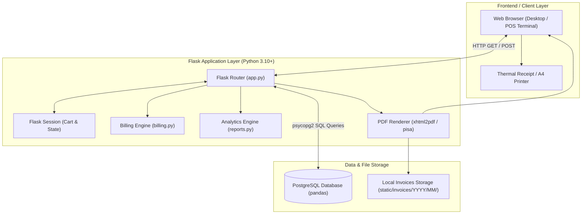
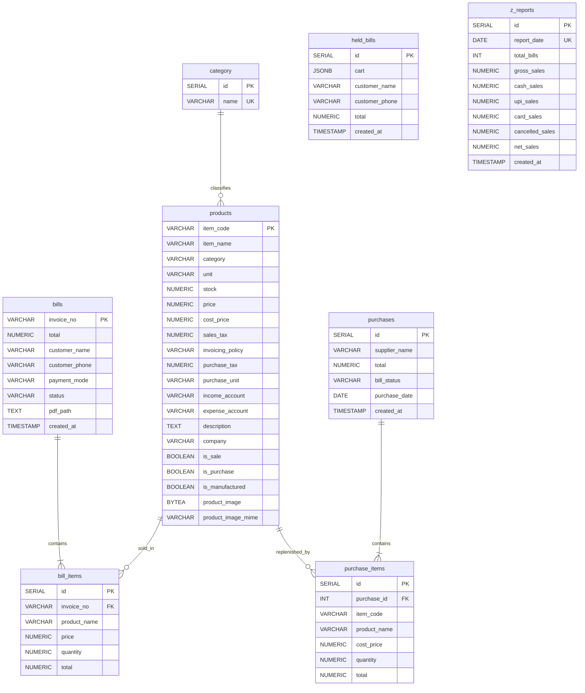

# 🐼 PANDAS – Point of Sale (POS) & Retail Management System


**PANDAS** is a lightweight, full-featured **Point of Sale (POS), Inventory Control, Supplier Purchase Tracking, and Financial Settlement System** built with Python and Flask, powered by a relational PostgreSQL database.

Designed specifically for FMCG, confectioneries, dry fruit & nut merchants, and retail convenience stores, PANDAS delivers rapid checkout, live cart management, transaction parking (Hold/Resume), automated invoice PDF generation, automated inventory adjustments, and end-of-day **Daily Z-Report** accounting settlements.

---

## 📑 Table of Contents

- [Key Features](#-key-features)
- [System Architecture & Data Flow](#-system-architecture--data-flow)
- [Database Architecture & ER Diagram](#-database-architecture--er-diagram)
- [Directory Structure](#-directory-structure)
- [Tech Stack](#-tech-stack)
- [Item Code Nomenclature](#-item-code-nomenclature)
- [Installation & Setup Guide](#-installation--setup-guide)
  - [Prerequisites](#prerequisites)
  - [1. Clone / Open Project](#1-clone--open-project)
  - [2. Virtual Environment Setup](#2-virtual-environment-setup)
  - [3. Install Dependencies](#3-install-dependencies)
  - [4. PostgreSQL Database Initialization](#4-postgresql-database-initialization)
  - [5. Database Credentials Configuration](#5-database-credentials-configuration)
  - [6. Import Product Catalog](#6-import-product-catalog)
  - [7. Run the Application](#7-run-the-application)
- [Application Walkthrough & Workflows](#-application-walkthrough--workflows)
- [Route & API Reference](#-route--api-reference)
- [Configuration & Production Deployment](#-configuration--production-deployment)
- [Troubleshooting & FAQ](#-troubleshooting--faq)
- [Future Roadmap](#-future-roadmap)

---

## 🚀 Key Features

### 🧾 1. Fast Point of Sale (POS) & Billing
- **Category-Based Filtering:** Rapidly toggle between product departments (*Chocolates, Nuts, Dates, Dry Fruits, Drinks, Mill Products*).
- **Dynamic Cart Management:** Add items with decimal quantities, edit quantities, and perform inline price adjustments on the fly.
- **Hold & Resume Bills (Parked Transactions):** Park a customer's active cart into the database (`held_bills`) when they need more time, serve subsequent customers, and resume the transaction with a single click.
- **Customer & Payment Tracking:** Log customer details (name and phone number) and choose payment modes: `Cash`, `UPI`, or `Card`.
- **Automated Sequential Invoicing:** Generates formatted invoice numbers according to year and sequence: `INV-YYYY-XXXXX` (e.g., `INV-2026-00001`).
- **Real-Time Stock Decrement:** Product stock levels automatically decrease upon finalizing checkout.
- **Automated PDF Archival:** Converts bills into printable PDF invoices via `xhtml2pdf`, automatically archived into time-partitioned folders (`static/invoices/YYYY/MM/`).
- **Thermal & A4 Print Support:** Print-optimized styling for receipts and invoices (`window.print()`).
- **Searchable Bill History:** View historical transactions with instant full-text filtering by invoice number or customer name.

### 📦 2. Product Master & Inventory Control
- **Comprehensive Product Profiles:** Tracks Item Code, Product Name, Category, Stock Level, Unit of Measure (`kg`, `pc`, etc.), Sale Price, Cost Price, Sales Tax %, Purchase Tax %, Invoicing Policy, Ledger Accounts (Income/Expense), and Brand/Company.
- **Auto-Generated Item Codes:** Generates structured category-prefixed SKU codes (e.g., `C101`, `N101`, `F101`).
- **Product Image Management:** Direct binary image upload stored as `BYTEA` in PostgreSQL and streamed via dedicated HTTP endpoints.
- **Quick Price & Stock Editing:** Inline modifications directly from the product catalog table.
- **Bulk CSV Ingestion:** Comes with `prod_import.py` to seed or bulk-update inventory from `products.csv` with conflict-safe SQL (`ON CONFLICT DO NOTHING`).

### 🛒 3. Supplier Purchase & Stock Inflow
- **Multi-Line Purchase Entry:** Record supplier bills with supplier name, purchase date, invoice payment status, and individual item costs.
- **Automated Stock Increment:** Entering purchases automatically replenishes item quantities in the inventory master.
- **Purchase History Auditing:** Filter historical purchases by supplier name and transaction date to inspect unit costs and totals.

### 📊 4. Financial Analytics & Daily Z-Report
- **Date-Range Sales Reports:** Filter total sales volume and revenue by custom date intervals (`From Date` to `To Date`).
- **Category & Item Analytics:** Granular breakdown of units sold and gross sales per category and product.
- **End-of-Day Daily Z-Report (`/z-report`):**
  - Instant audit summarizing **Total Bills**, **Gross Sales**, **Cancelled Sales**, and **Net Sales**.
  - Payment channel breakdown: **Cash Sales**, **UPI Sales**, and **Card Sales**.
  - **Audit Immutability:** Once generated for a given date, the Z-Report locks and stores the snapshot in the `z_reports` table to prevent tampering.
  - Receipt-style print template with automated browser print trigger.

---

## 🏗 System Architecture & Data Flow



---

## 🗄 Database Architecture & ER Diagram

The database uses PostgreSQL (`pandas`) with foreign key constraints and transactional integrity.



---

## 📁 Directory Structure

```text
pandass/
│
├── app.py                      # Main Flask application controller, routing & business logic
├── db.py                       # PostgreSQL connection helper (psycopg2)
├── billing.py                  # POS arithmetic and cart calculation routines
├── reports.py                  # Reporting queries & daily sales aggregation
├── prod_import.py              # Catalog seeding script from CSV into PostgreSQL
├── products.csv                # Sample product inventory catalog
├── schema.sql                  # Complete PostgreSQL DDL database setup script
├── requirements.txt            # Python dependencies specification
├── README.md                   # Project documentation
│
├── static/
│   ├── css/
│   │   └── style.css           # Global UI styling, card layouts & print rules
│   ├── images/
│   │   ├── logo.png            # Main brand header logo
│   │   ├── logob.png           # Alternate brand logo
│   │   └── logoo.png           # Dashboard brand emblem
│   └── invoices/               # Auto-generated PDF bills archive
│       └── 2026/
│           ├── 02/             # Partitioned invoices for Feb 2026
│           └── 03/             # Partitioned invoices for Mar 2026
│
└── templates/
    ├── dashboard.html          # Central navigation launchpad
    ├── billing.html            # Main Point of Sale checkout console
    ├── verify_bill.html        # Customer confirmation & payment mode selection
    ├── bill.html               # Bill receipt template (rendered in HTML and PDF)
    ├── bills_list.html         # Historical invoices listing with search
    ├── products.html           # Product list view with quick price/stock updates
    ├── product_form.html       # Full ERP product creation and edit screen
    ├── purchase.html           # Supplier purchase entry form
    ├── purchase_history.html   # Purchase records search & detailed audit viewer
    ├── reports.html            # Date-filtered sales and category performance reports
    ├── z_report.html           # End-of-day Z-Report settlement slip
    └── login.html              # Optional authentication splash
```

---

## 💻 Tech Stack

- **Frontend Architecture:** [React 18](https://react.dev/), [Vite](https://vitejs.dev/), [React Router DOM v6](https://reactrouter.com/)
- **UI Styling & Icons:** [Tailwind CSS v3.4](https://tailwindcss.com/), [Lucide React](https://lucide.dev/)
- **HTTP Client:** [Axios](https://axios-http.com/) (with credentials support & proxying)
- **Backend Framework:** [Flask](https://palletsprojects.com/p/flask/) (Python 3.10+) RESTful JSON APIs
- **Database Engine:** [PostgreSQL](https://www.postgresql.org/) (Version 12 or newer)
- **Database Driver:** [psycopg2-binary](https://pypi.org/project/psycopg2-binary/)
- **PDF Engine:** [xhtml2pdf](https://github.com/xhtml2pdf/xhtml2pdf) (`pisa`)
- **Templating:** Jinja2 (for automated PDF invoice compilation)

---

## 🏷 Item Code Nomenclature

PANDAS automatically prefixes and increments product SKU numbers based on their department:

| Category Prefix | Department | Example Item Code | Numbering Range |
| :---: | :--- | :---: | :--- |
| **`C`** | Chocolates | `C101` | C101 – C999 |
| **`N`** | Nuts | `N101` | N101 – N999 |
| **`D`** | Dates | `D101` | D101 – D999 |
| **`F`** | Dry Fruits | `F101` | F101 – F999 |
| **`W`** | Drinks & Beverages | `W101` | W101 – W999 |
| **`M`** | Mill Products | `M101` | M101 – M999 |

When creating a new product via the UI, selecting the category automatically scans existing codes in PostgreSQL and suggests the next sequence number (e.g. `C101` $\rightarrow$ `C102`).

---

## ⚙️ Installation & Setup Guide

### Prerequisites
1. **Python 3.10 or higher** installed on your system.
2. **PostgreSQL 12+** server installed and running.
3. Access to `psql` or a database administration client (e.g., pgAdmin, DBeaver).

---

### 1. Clone / Open Project
Open your terminal or PowerShell and navigate to the project root:
```powershell
cd c:\Users\Admin\PycharmProjects\PythonProject\pandass
```

### 2. Virtual Environment Setup
Create and activate an isolated Python virtual environment:

**On Windows (PowerShell):**
```powershell
python -m venv venv
.\venv\Scripts\Activate.ps1
```

**On Linux / macOS:**
```bash
python3 -m venv venv
source venv/bin/activate
```

### 3. Install Dependencies
Install all required Python libraries from `requirements.txt`:
```bash
pip install -r requirements.txt
```

*(Core dependencies: `Flask`, `psycopg2-binary`, `xhtml2pdf`)*

---

### 4. PostgreSQL Database Initialization

Log in to your PostgreSQL instance using `psql` or pgAdmin and create the database:
```sql
CREATE DATABASE pandas;
```

Execute the database schema setup using the bundled `schema.sql`:

**Via Command Line:**
```bash
psql -U postgres -d pandas -f schema.sql
```

*(Or copy the contents of `schema.sql` into pgAdmin Query Tool and execute).*

---

### 5. Database Credentials Configuration
Open `db.py` and verify or update your PostgreSQL connection parameters:

```python
# db.py
import psycopg2

def get_db_connection():
    return psycopg2.connect(
        host="localhost",
        database="pandas",
        user="postgres",       # Your PostgreSQL username
        password="Postgres123", # Your PostgreSQL password
        port=5432
    )
```

> [!TIP]
> In production environments, replace hardcoded credentials with environment variables (`os.getenv(...)`).

---

### 6. Import Product Catalog
Populate the database with the initial catalog of products from `products.csv`:

```bash
python prod_import.py
```

*Expected output:*
```text
✅ Products imported successfully
```

---

### 7. Run the Application

#### Option A: One-Click Startup (Windows)
Double-click `start.bat` or run:
```powershell
.\start.ps1
```
*(This automatically opens the Flask backend on port 5000 and the Vite React frontend on port 5173 in separate terminals).*

#### Option B: Manual Command Line Startup (Recommended for Development)

**Terminal 1 — Flask API Backend:**
```powershell
# Navigate to backend directory and start Flask
cd backend
python app.py
```
*Backend runs at: `http://localhost:5000`*

**Terminal 2 — Modern React Frontend:**
```powershell
# In a second terminal, navigate to frontend and start Vite
cd frontend
npm run dev
```
*Frontend runs at: `http://localhost:5173`*

Open your browser and navigate to: **`http://localhost:5173`**
*(Vite proxies API calls to `http://localhost:5000` automatically).*

---

## 🧭 Application Walkthrough & Workflows

### 🛒 1. Billing & Checkout Workflow
1. Navigate to **🧾 Billing** (`/billing`).
2. Select a category on the left sidebar (e.g., *Chocolates*).
3. Select an item and quantity, then click **Add to Cart**.
4. Adjust prices or quantities directly in the cart table if needed.
5. If the customer steps away, click **⏸ Hold Bill** to park the bill. Resume it later from the **Held Bills** drawer.
6. Enter customer name, phone number, and choose payment mode (`Cash`, `UPI`, `Card`).
7. Click **Confirm & Checkout**.
8. The system:
   - Decrements stock in the `products` table.
   - Generates an invoice number (e.g., `INV-2026-00001`).
   - Renders and archives a PDF bill in `static/invoices/YYYY/MM/`.
   - Opens the printable bill preview (`/bill/INV-2026-00001`).

### 📦 2. Stock Replenishment (Purchases)
1. Navigate to **🛒 Purchase** (`/purchase`).
2. Fill in the **Supplier / Shop Name** and **Purchase Date**.
3. Choose item categories, pick items, and enter purchased quantities and unit cost prices.
4. Click **Save Purchase**.
5. Stock for all purchased items automatically increases in the database.
6. Inspect previous shipments and costs under **📜 View Purchase History** (`/purchase/history`).

### 📊 3. End-of-Day Settlement (Daily Z-Report)
1. At closing time, navigate to **📊 Reports** $\rightarrow$ **Daily Z-Report** (`/z-report`).
2. The system aggregates all completed (`PAID`) transactions for the current date.
3. Total sales are broken down by payment mode (`Cash`, `UPI`, `Card`), minus any cancelled receipts.
4. The settlement record is permanently stored in `z_reports`.
5. The print dialog triggers automatically (`window.print()`) for the thermal receipt printer.

---

## 🛣 Route & API Reference

| Endpoint | Methods | Description |
| :--- | :---: | :--- |
| `/` | `GET` | Dashboard home with quick navigation cards |
| `/billing` | `GET`, `POST` | Primary POS checkout terminal and cart session |
| `/update-qty/<int:index>` | `POST` | Update item quantity in active cart |
| `/update-price/<int:index>` | `POST` | Override unit price in active cart |
| `/remove-item/<int:index>` | `GET` | Delete an item from the active cart |
| `/hold-bill` | `GET` | Park current cart into `held_bills` table |
| `/resume-bill/<int:hold_id>` | `GET` | Restore parked bill back into active cart |
| `/verify-bill` | `POST` | Verify customer info & payment mode |
| `/checkout` | `GET` | Finalize sale, decrement stock, generate PDF invoice |
| `/bill/<invoice_no>` | `GET` | View formatted HTML bill in browser |
| `/bill/<invoice_no>/pdf` | `GET` | Download generated PDF invoice file |
| `/bills` | `GET`, `POST` | Invoice history list with search filtering |
| `/purchase` | `GET` | Supplier purchase entry screen |
| `/get-items/<category>` | `GET` | JSON endpoint returning products for purchase category |
| `/purchase/save` | `POST` | Record purchase bill & increment inventory stock |
| `/purchase/history` | `GET` | View and filter historical purchases by supplier/date |
| `/products` | `GET`, `POST` | Product inventory table with inline quick updates |
| `/products/form` | `GET` | Detailed product management form (create/edit) |
| `/products/update` | `POST` | Save or update full product master details & images |
| `/update-product/<item_code>` | `POST` | Quick inline price & stock updater |
| `/delete-product/<item_code>` | `GET` | Remove a product from inventory |
| `/product-image/<item_code>` | `GET` | Stream stored binary product image (`BYTEA`) |
| `/reports` | `GET`, `POST` | Sales analytics with date range filters |
| `/z-report` | `GET`, `POST` | Daily closing Z-Report generation & thermal print |

---

## 🔒 Configuration & Production Deployment

### 1. Secret Key Security
In `app.py`, change the default secret key to a cryptographically secure random string:
```python
import os
app.secret_key = os.environ.get("FLASK_SECRET_KEY", "your-secure-random-key-here")
```

### 2. Running Behind a Production WSGI Server
Do not use `app.run(debug=True)` in production. Instead, run with a production WSGI server:

**Using Waitress (Recommended for Windows):**
```bash
pip install waitress
waitress-serve --port=5000 app:app
```

**Using Gunicorn (for Linux servers):**
```bash
pip install gunicorn
gunicorn -w 4 -b 0.0.0.0:5000 app:app
```

---

## ❓ Troubleshooting & FAQ

### 1. `psycopg2.OperationalError: connection to server at "localhost" failed`
- **Cause:** PostgreSQL service is stopped or port `5432` is blocked.
- **Solution:** Verify the PostgreSQL service is running:
  - *Windows:* Open `services.msc` and check that `postgresql-x64-XX` is running.
  - *Linux:* Run `sudo systemctl status postgresql`.
- Check credentials in `db.py`.

### 2. `PermissionError: [WinError 5] Access is denied: 'static/invoices/...'`
- **Cause:** Flask lacks write permissions to write the generated PDF invoices.
- **Solution:** Ensure the user running Python has write permissions on the `static/invoices` folder.

### 3. xhtml2pdf styling looks different than HTML
- **Note:** `xhtml2pdf` supports a subset of CSS2. Avoid advanced CSS Flexbox or Grid properties inside `bill.html`; standard HTML tables (`<table>`) are recommended for PDF rendering consistency.

---

## 🔮 Future Roadmap

- [ ] **Role-Based Access Control (RBAC):** Admin, Manager, and Cashier permission tiers.
- [ ] **Barcode Scanner Support:** Instant item addition via USB/Bluetooth barcode readers.
- [ ] **Thermal ESC/POS Direct Printing:** Network socket printing directly to thermal receipt printers (80mm/58mm).
- [ ] **Customer Loyalty & Ledger:** Track customer credits and loyalty reward points.
- [ ] **Automated Low-Stock Alerts:** Email/SMS notifications when inventory falls below minimum reorder levels.

---

## 📄 License

This software is developed for proprietary retail and Point of Sale management. All rights reserved.

